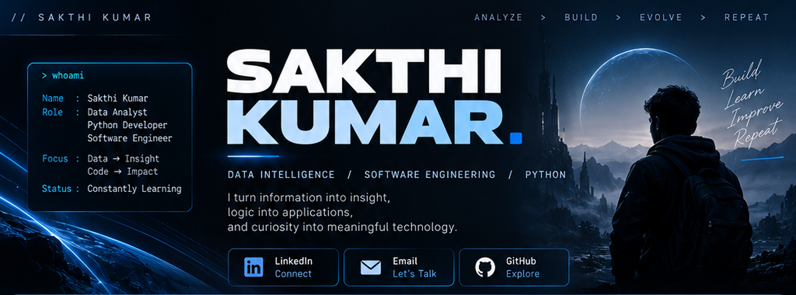
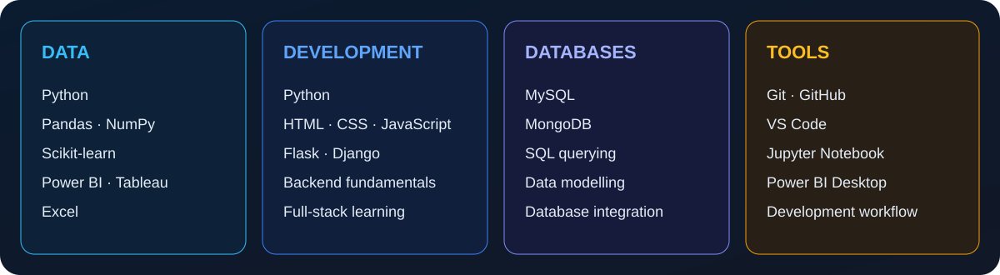

 

  

**DATA INTELLIGENCE&nbsp; / &nbsp;PYTHON DEVELOPMENT&nbsp; / &nbsp;SOFTWARE ENGINEERING**

*Turning information into insight. Turning logic into useful applications.*

---

<table>
<tr>
<td width="58%" valign="top">

### 01 — THE PERSON BEHIND THE CODE

I'm a Computer Science Engineering graduate interested in the space where **data, programming and practical problem-solving** meet.

I enjoy exploring datasets, understanding how systems work, and building applications that solve clearly defined problems. My approach is grounded in learning fundamentals, experimenting through implementation, and improving the quality of what I build.

</td>
<td width="42%" valign="top">

### WORKING PRINCIPLES

| | |
|:--|:--|
| ◈ | Understand the problem |
| ◈ | Think in systems |
| ◈ | Build with clarity |
| ◈ | Learn by implementation |
| ◈ | Improve continuously |

</td>
</tr>
</table>

### HOW I APPROACH A PROBLEM

---

## 02 — TECHNOLOGY MAP

<b>Explore the tools and technologies</b>

**Data & intelligence**
- Python, Pandas, NumPy, Scikit-learn
- Power BI, Tableau, Advanced Excel
- Exploratory data analysis, data cleaning, visualization and machine-learning fundamentals

**Software development**
- Python, HTML, CSS, JavaScript
- Flask and Django
- Backend fundamentals and full-stack development

**Databases**
- MySQL, MongoDB
- SQL, relational database concepts and application integration

**Tools**
- Git, GitHub, VS Code, Jupyter Notebook

---

## 03 — AREAS I EXPLORE

<table>
<tr>
<td width="50%" valign="top">

#### ◉ DATA INTELLIGENCE

- Exploratory data analysis
- Data preparation and cleaning
- Predictive modelling
- Business intelligence
- Visual storytelling with data

</td>
<td width="50%" valign="top">

#### ◉ APPLICATION ENGINEERING

- Python application development
- Backend logic
- REST API fundamentals
- Database-driven applications
- Full-stack development

</td>
</tr>
<tr>
<td width="50%" valign="top">

#### ◉ SYSTEMS & LOGIC

- Problem decomposition
- Application architecture
- Database design
- Automation
- Maintainable code

</td>
<td width="50%" valign="top">

#### ◉ CONTINUOUS EXPLORATION

- Advanced Python
- FastAPI
- API architecture
- Modern web technologies
- Scalable application patterns

</td>
</tr>
</table>

---

## 04 — CURRENT VECTOR

My current learning direction is to strengthen backend development, understand API design, work confidently with databases, and build complete applications through hands-on implementation.

---

## 05 — GITHUB SIGNALS

  

  

GitHub statistics are generated by third-party services and may occasionally be unavailable or delayed.

---

## THE NEXT COMMIT

### Curiosity drives exploration.
### Logic drives creation.

**SAKTHI KUMAR**

[LinkedIn](https://www.linkedin.com/in/sakthikumar1) &nbsp;·&nbsp; [Email](mailto:b.sakthikumar10@gmail.com) &nbsp;·&nbsp; [GitHub](https://github.com/sakthikumar-1)

INDEPENDENT THINKING&nbsp; · &nbsp;CONTINUOUS LEARNING&nbsp; · &nbsp;PURPOSEFUL ENGINEERING

