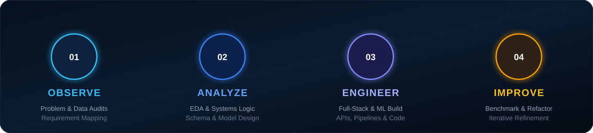

<!-- DYNAMIC TYPING SVG HEADER -->

  

<!-- HERO BANNER -->

  

<!-- INTERACTIVE CONNECT DOCK -->

&nbsp;

&nbsp;

&nbsp;

  

### **DATA INTELLIGENCE &nbsp;·&nbsp; PYTHON DEVELOPMENT &nbsp;·&nbsp; SOFTWARE ENGINEERING**

*Turning raw information into insight. Turning clean logic into impactful applications.*

---

### ⚡ The Person Behind the Code

I am a **Computer Science Engineering graduate** focused on the intersection where **data intelligence**, **backend software engineering**, and **systems thinking** meet.

I enjoy taking complex, unstructured datasets and distilling them into clear, predictive insights — as well as architecting robust, modular backend services that solve real-world problems. My engineering approach is grounded in first principles: understanding the fundamental system constraints before writing code, prioritizing clarity over cleverness, and iterating relentlessly toward high quality.

#### 💡 Working Principles
* **Understand Before Building** — Deconstruct the core problem and requirements to first principles.
* **Think in Systems** — Architect end-to-end data flows with scalability, maintainability, and reliability in mind.
* **Write Clear, Self-Documenting Logic** — Clean code, strong typing, and modular architectures that are built to last.
* **Learn by Implementation** — Cement technical depth through hands-on building, practical experimentation, and real-world delivery.
* **Iterate & Evolve Continuously** — Relentlessly benchmark, refactor, and elevate the standard of what I build.

---

### 🔄 Engineering Process

  

 

* **01 · OBSERVE** — Problem deconstruction, constraint mapping, stakeholder discovery, and data auditing.
* **02 · ANALYZE** — Exploratory data analysis, statistical modeling, relational schema architecture, and trade-off evaluation.
* **03 · ENGINEER** — Clean Python backend implementation, RESTful API design, database querying, and predictive intelligence.
* **04 · IMPROVE** — Benchmark testing, code refactoring, algorithmic optimization, and continuous refinement.

---

### 🗺️ Technology Landscape

  

 

#### 🛠️ Tech Stack & Skill Matrix

* **Languages & Core**  
  `Python` &nbsp;·&nbsp; `SQL` &nbsp;·&nbsp; `JavaScript` &nbsp;·&nbsp; `HTML5` &nbsp;·&nbsp; `CSS3` &nbsp;·&nbsp; `C / C++`

* **Data Intelligence & Machine Learning**  
  `Pandas` &nbsp;·&nbsp; `NumPy` &nbsp;·&nbsp; `Scikit-Learn` &nbsp;·&nbsp; `Matplotlib` &nbsp;·&nbsp; `Seaborn` &nbsp;·&nbsp; `Power BI` &nbsp;·&nbsp; `Tableau` &nbsp;·&nbsp; `Advanced Excel`

* **Software & Backend Engineering**  
  `FastAPI` &nbsp;·&nbsp; `Flask` &nbsp;·&nbsp; `Django` &nbsp;·&nbsp; `RESTful APIs` &nbsp;·&nbsp; `Jinja2` &nbsp;·&nbsp; `Backend Architecture`

* **Databases & Storage**  
  `MySQL` &nbsp;·&nbsp; `MongoDB` &nbsp;·&nbsp; `PostgreSQL` &nbsp;·&nbsp; `Relational Schema Design` &nbsp;·&nbsp; `Query Optimization`

* **Developer Tools & Ecosystem**  
  `Git` &nbsp;·&nbsp; `GitHub` &nbsp;·&nbsp; `VS Code` &nbsp;·&nbsp; `Jupyter Notebook` &nbsp;·&nbsp; `Linux / WSL` &nbsp;·&nbsp; `Postman`

🔍 <b>Click to expand detailed competency breakdown</b>

 

* **Data Intelligence & Predictive Analytics**:
  * Extensive experience in Exploratory Data Analysis (EDA), automated data cleaning, outlier detection, and feature engineering.
  * Applied machine learning: classification, regression, clustering, model evaluation, and cross-validation with Scikit-learn.
  * Executive dashboarding and visual storytelling with Power BI (DAX, data modeling) and Tableau.
* **Backend Application Engineering**:
  * Clean object-oriented programming in Python, adhering to SOLID principles and design patterns.
  * High-performance API design with FastAPI and Flask, including request validation and error handling.
  * Relational database design, normalization, ACID compliance, and indexing strategies in MySQL and PostgreSQL.
* **Engineering Workflow**:
  * Version control with Git/GitHub, structured commit hygiene, branch management, and collaborative development.
  * REST API testing with Postman, environment management, and rapid prototyping with Jupyter.

---

### 🎯 Core Domains of Exploration

#### 📊 Data Intelligence
* **Exploratory Data Analysis (EDA)**: Extracting actionable signal and hidden patterns from high-dimensional datasets.
* **ETL & Data Cleaning**: Automated pipeline scripts, data normalization, missing value imputation, and validation.
* **Predictive Modeling**: Supervised machine learning algorithms, model evaluation metrics, and hyperparameter tuning.
* **Business Intelligence & Dashboards**: Interactive KPI reporting, DAX calculations, and executive visual reporting.

#### ⚙️ Application Engineering
* **Python Backend Development**: Modular, scalable architecture utilizing clean OOP and reusable components.
* **RESTful API Design**: Stateless endpoint architectures, structured JSON payloads, and robust error contracts.
* **Database Integration**: Seamless application-to-database interfaces, schema migrations, and optimized queries.
* **Full-Stack Prototyping**: Connecting responsive frontends with robust, data-backed Python backends.

#### 🧩 Systems & Logic
* **Problem Decomposition**: Deconstructing large, ambiguous challenges into modular, testable units.
* **Application Architecture**: Decoupling presentation layers from business logic and database interactions.
* **Database Modeling**: Designing efficient schemas, indexing key columns, and ensuring referential integrity.
* **Automation**: Automating repetitive data transformations and system workflows with clean Python scripts.

#### 🚀 Continuous Exploration
* **Modern API Architecture**: High-throughput asynchronous endpoints with FastAPI and Pydantic validation.
* **Advanced Python**: Concurrency (`asyncio`), decorators, generators, and memory-efficient data structures.
* **Scalable Patterns**: Microservice decomposition, caching strategies, and containerization fundamentals.

---

### 📍 Current Vector

&nbsp;

&nbsp;

 

> **Active Focus**: Strengthening production-grade backend engineering with FastAPI, designing high-throughput API microservices, mastering advanced relational database querying and optimization, and shipping complete, end-to-end data-driven applications.

---

### 📈 GitHub Real-Time Signals

&nbsp;

  

---

### ✦ THE NEXT COMMIT ✦

#### *Curiosity drives exploration. Logic drives creation.*

 

**SAKTHI KUMAR B**  
*Computer Science & Engineering Graduate &nbsp;·&nbsp; Data Intelligence & Software Engineer*

 

&nbsp;

&nbsp;

  

`INDEPENDENT THINKING` &nbsp;·&nbsp; `CONTINUOUS LEARNING` &nbsp;·&nbsp; `PURPOSEFUL ENGINEERING`

 

[⬆ Back to Top](#top)

